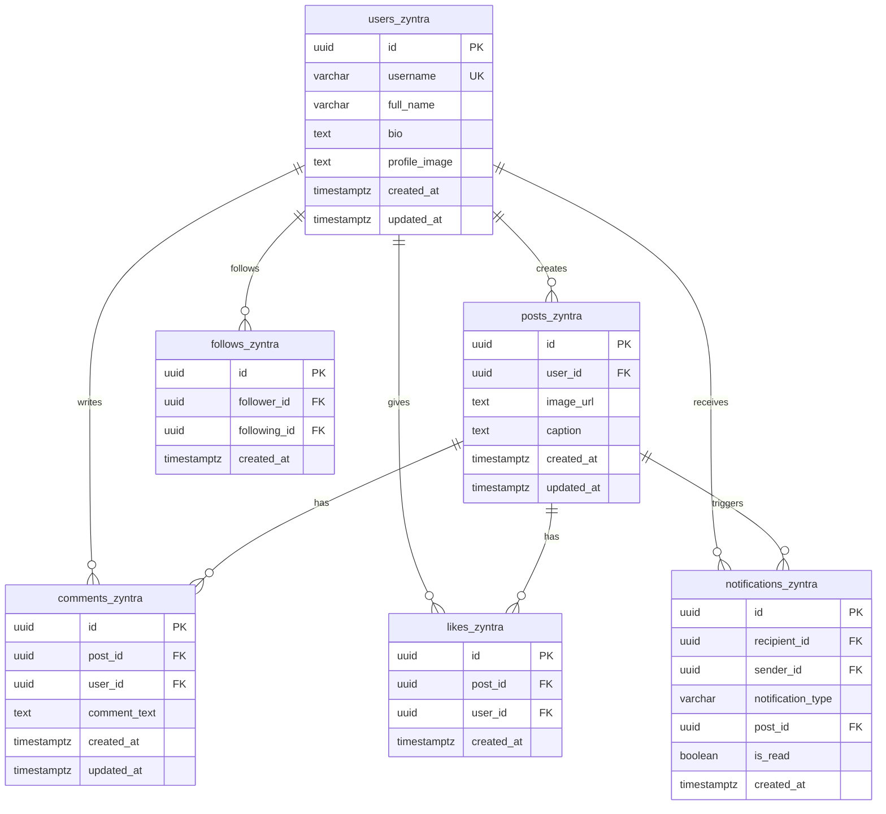

# ZYNTRA – Full-Stack Modern Social Media Platform

> **Tagline:** *Connect. Share. Discover.*

**ZYNTRA** is a full-stack, responsive social media platform inspired by Instagram. It delivers a modern networking experience allowing creators to express themselves, publish visual stories, interact with community members, like and comment on posts, and build dynamic follow networks.

Built with a performant **Node.js & Express** backend, a **Vanilla JavaScript & HTML5/CSS3** frontend (no heavy frameworks), and powered by **Supabase PostgreSQL, Supabase Authentication, and Supabase Storage**.

---

## 🌟 Key Features

### 1. Public Landing Page
- Accessible without authentication.
- Brand navbar with ZYNTRA logo, navigation links, Sign In, and Get Started CTA.
- Hero section: *"Your World. Your Stories. Your Community."*
- Interactive live feed preview mockup.
- Comprehensive feature breakdown and 3-step *"How It Works"* section.
- Fully responsive across desktop, tablet, and mobile viewports.

### 2. Authentication System (Supabase Auth)
- User registration with instant profile provisioning.
- Secure email & password sign-in with persistent sessions.
- Live username uniqueness & availability validation.
- Password recovery and reset flow (`/forgot-password`).
- Route guards and JWT validation middleware.

### 3. User Profiles & Customization
- Dedicated personal profile page (`/profile`) and other users' profile page (`/user/:username`).
- Profile picture uploads directly stored in Supabase Storage (`zyntra-avatars`).
- Unique usernames, full name, custom bio, and registration timestamp.
- Real-time counters for **Posts**, **Followers**, and **Following**.
- Instagram-style 3-column media grid with hover stats (likes & comments count).
- Full profile editor (`/edit-profile`) with instant avatar preview.

### 4. Post Publishing & Media Management
- Image post creation (`/create-post`) with drag-and-drop dropzone.
- Automatic storage in Supabase Storage (`zyntra-posts`).
- Multi-line caption support with character counter (up to 2,200 characters).
- Client-side and server-side file type (JPEG, PNG, WEBP, GIF) and file size (up to 10MB) validation.
- Edit caption capability and post deletion for post owners.
- Direct link copying and sharing.

### 5. Instagram-Style Feed
- Chronological ordering with newest posts first (`/feed`).
- Shows posts from followed creators and the authenticated user.
- Automatic discovery fallback for new users so the feed is never empty.
- Infinite scroll / *"Load More Posts"* pagination.
- Top creator stories carousel.
- Right desktop sidebar featuring account summary, suggested creators to follow, and quick links.

### 6. Interactive Likes System
- Instant like / unlike toggling with immediate counter update.
- **Double-tap on post image** triggers animated heart burst.
- Clickable like counter opens **Likes Modal** showing users who liked the post with follow/unfollow buttons.
- Database unique constraint prevents duplicate likes.
- Automatic in-app notification sent to post author when someone likes their post.

### 7. Rich Comments System
- Full comment section on individual post detail view (`/post/:id`).
- Inline quick-comment input on feed cards.
- View comments ordered chronologically with author avatar, username, and relative timestamps (*"5m ago"*, *"2h ago"*).
- Post owners and comment authors can edit or delete comments.
- Automatic in-app notification sent to post author on new comments.

### 8. Follow / Unfollow Community Graph
- Follow and unfollow creators with reactive button states.
- Dedicated **Followers** (`/user/:username/followers`) and **Following** (`/user/:username/following`) lists.
- Strict database constraints prevent self-following and duplicate relationships.
- Follow status dynamically synchronizes across all cards and feeds.

### 9. In-App Notifications
- Real-time notifications for:
  - 👤 New follower: *"@username started following you."*
  - ❤️ Post like: *"@username liked your post."*
  - 💬 Comment: *"@username commented on your post."*
- Read and unread states with highlight indicator and unread count badge on navigation.
- Mark single notification or all notifications as read.
- Quick navigation to corresponding post or user profile.

### 10. Explore & Discovery
- Search creators by username or name with live debounced search (`/explore`).
- Visual explore post grid with hover overlay.
- Recommended creator cards with one-click follow action.

---

## 🛠️ Technology Stack

| Layer | Technologies |
|---|---|
| **Frontend** | HTML5, CSS3 (Custom Design System), Vanilla JavaScript (ES6+), [Lucide Icons](https://lucide.dev/) |
| **Backend** | Node.js, Express.js, Multer |
| **Database** | Supabase PostgreSQL with Row Level Security (RLS) |
| **Auth** | Supabase Authentication (JWT & Sessions) |
| **Storage** | Supabase Storage (`zyntra-avatars`, `zyntra-posts`) with local fallback |

*No frontend frameworks (React, Next.js, Vue) are used as per requirements.*

---

## 🗄️ Database Design (`_zyntra` Suffix Rule)

All application-created database tables strictly follow the mandatory `_zyntra` naming convention:



### Row Level Security (RLS) Policies
- All 6 application tables have Row Level Security enabled.
- Public read access for profiles, posts, comments, likes, and follows.
- Write/update/delete permissions are strictly restricted to the content owner (`auth.uid() = user_id`).
- Post owners can also moderate and delete comments left on their posts.
- Notifications are strictly private to the recipient (`auth.uid() = recipient_id`).

---

## 📁 Project Directory Structure

```
CodeAlpha_SocialMediaPlatform/
├── public/
│   ├── css/
│   │   └── style.css            # Premium dark navy & violet design system
│   ├── js/
│   │   ├── supabaseClient.js   # Supabase client factory & session provider
│   │   ├── api.js              # Fetch wrapper with JWT injection & error handling
│   │   ├── ui.js               # Lucide icons, toast alerts, modals, heart burst
│   │   ├── auth.js             # Supabase Auth logic & route guards
│   │   └── components.js       # Desktop sidebar, mobile nav, post card renderer
│   ├── index.html              # 1. Public Landing Page
│   ├── register.html           # 2. Register Page
│   ├── login.html              # 3. Login Page
│   ├── forgot-password.html    # 4. Forgot / Reset Password Page
│   ├── feed.html               # 5. Home Feed Page
│   ├── explore.html            # 6. Explore Users & Posts Page
│   ├── create-post.html        # 7. Create Post Page
│   ├── post.html               # 8. Individual Post Details Page
│   ├── profile.html            # 9. My Profile Page
│   ├── edit-profile.html       # 10. Edit Profile Page
│   ├── user.html               # 11. Other User Profile Page
│   ├── followers.html          # 12. Followers List Page
│   ├── following.html          # 13. Following List Page
│   ├── notifications.html      # 14. Notifications Page
│   └── settings.html           # 15. Account Settings Page
├── server/
│   ├── config/
│   │   └── supabase.js         # Supabase client & storage upload configuration
│   ├── controllers/
│   │   ├── authController.js   # Auth metadata, username check, profile sync
│   │   ├── userController.js   # Profile details, stats, avatar, user search
│   │   ├── postController.js   # Feed, post creation, explore, edit, delete
│   │   ├── likeController.js   # Like toggling and likers modal list
│   │   ├── commentController.js# Comments stream, create, update, delete
│   │   ├── followController.js # Follow / unfollow operations and lists
│   │   └── notificationController.js # In-app notifications & read states
│   ├── middleware/
│   │   ├── authMiddleware.js   # JWT verification & profile provisioning
│   │   └── uploadMiddleware.js # Multer image upload & size validation
│   ├── routes/
│   │   └── api.js              # Express REST API routes
│   └── server.js               # Express server entry point & static file routing
├── tests/
│   └── unit.test.js            # Automated verification test suite (46 checks)
├── supabase-schema.sql         # Complete PostgreSQL schema, constraints & RLS
├── .env.example                # Template for environment variables
├── .gitignore                  # Git ignore rules for node_modules, .env, uploads
├── package.json
└── README.md
```

---

## 🚀 Getting Started

### Prerequisites
- [Node.js](https://nodejs.org/) v18.0.0 or higher
- [Supabase](https://supabase.com/) Account (Free tier works perfectly)

### 1. Clone the Repository
```bash
git clone https://github.com/<your-username>/CodeAlpha_SocialMediaPlatform.git
cd CodeAlpha_SocialMediaPlatform
```

### 2. Install Dependencies
```bash
npm install
```

### 3. Supabase Setup

1. Create a new project in the [Supabase Dashboard](https://supabase.com/dashboard).
2. Go to **SQL Editor** in your Supabase Dashboard.
3. Open [`supabase-schema.sql`](./supabase-schema.sql) from this repository, copy its contents, paste them into the SQL Editor, and click **Run**.
   - This creates all 6 tables ending in `_zyntra`.
   - Enables Row Level Security (RLS) and attaches all security policies.
   - Creates the storage buckets `zyntra-avatars` and `zyntra-posts`.
   - Creates indexes, unique constraints, and the automatic profile sync trigger.
4. Go to **Project Settings** -> **API** to copy:
   - **Project URL**
   - **anon / public key**
   - **service_role key** (keep secret)

### 4. Configure Environment Variables

Copy `.env.example` to `.env`:
```bash
cp .env.example .env
```

Edit `.env` and fill in your Supabase credentials:
```env
PORT=5000
NODE_ENV=development

SUPABASE_URL=https://your-project-id.supabase.co
SUPABASE_ANON_KEY=your-supabase-anon-key-here
SUPABASE_SERVICE_ROLE_KEY=your-supabase-service-role-key-here

SUPABASE_AVATARS_BUCKET=zyntra-avatars
SUPABASE_POSTS_BUCKET=zyntra-posts
```

### 5. Run Verification Tests
```bash
npm test
```
All 46 unit and structural tests will run and pass.

### 6. Start the Application
```bash
# Production mode:
npm start

# Development mode (with auto-reload):
npm run dev
```

Open your browser and navigate to:
```
http://localhost:5000
```

---

## 📡 API Reference Overview

| Method | Endpoint | Description | Auth Required |
|---|---|---|:---:|
| `GET` | `/api/health` | Health check & platform info | No |
| `GET` | `/api/config` | Safe Supabase client configuration | No |
| `GET` | `/api/auth/check-username` | Verify username availability | No |
| `POST` | `/api/auth/sync-profile` | Synchronize newly registered user | Yes |
| `GET` | `/api/users/me` | Logged-in profile with stats | Yes |
| `PUT` | `/api/users/me` | Update name, username, and bio | Yes |
| `POST` | `/api/users/me/avatar` | Upload new profile picture | Yes |
| `GET` | `/api/users/explore` | Discover and search creators | Optional |
| `GET` | `/api/users/:username` | View user profile by handle | Optional |
| `GET` | `/api/users/:username/posts`| View user's post grid | Optional |
| `POST` | `/api/posts` | Publish a new image post | Yes |
| `GET` | `/api/posts/feed` | Chronological home feed | Yes |
| `GET` | `/api/posts/explore` | Trending posts for explore grid | Optional |
| `GET` | `/api/posts/:id` | Single post details with comments | Optional |
| `PUT` | `/api/posts/:id` | Edit post caption | Yes |
| `DELETE` | `/api/posts/:id` | Delete post and associated data | Yes |
| `POST` | `/api/posts/:id/like` | Toggle like / unlike | Yes |
| `GET` | `/api/posts/:id/likes` | View users who liked post | Optional |
| `GET` | `/api/posts/:id/comments` | Retrieve comments for a post | Optional |
| `POST` | `/api/posts/:id/comments` | Post a comment on a post | Yes |
| `PUT` | `/api/comments/:commentId`| Edit comment text | Yes |
| `DELETE`| `/api/comments/:commentId`| Delete comment | Yes |
| `POST` | `/api/users/:id/follow` | Follow a user | Yes |
| `DELETE`| `/api/users/:id/follow` | Unfollow a user | Yes |
| `GET` | `/api/users/:username/followers` | List followers of user | Optional |
| `GET` | `/api/users/:username/following` | List following of user | Optional |
| `GET` | `/api/notifications` | User's in-app notifications | Yes |
| `GET` | `/api/notifications/unread-count`| Unread notification count | Yes |
| `PUT` | `/api/notifications/mark-read` | Mark notification(s) as read | Yes |

---

## 🎨 UI/UX Highlights
- **Premium Dark Palette:** Dark navy background (`#080c14`, `#0f172a`), deep violet/indigo accents (`#6366f1`, `#8b5cf6`, `#ec4899`), crisp card surfaces (`#131c2e`).
- **Responsive Layout:**
  - Desktop: Fixed sidebar navigation + central stream + suggestions aside.
  - Tablet: Collapsed icon sidebar + stream.
  - Mobile: Clean top bar + full-width feed + fixed bottom navigation bar.
- **Micro-Interactions:**
  - Double-tap heart animation on media.
  - Interactive toast notifications with auto-dismiss.
  - Smooth modal overlays for likers and caption editing.
  - Debounced search with live feedback.

---

## 📄 License
This project is licensed under the MIT License - see the LICENSE file for details.
